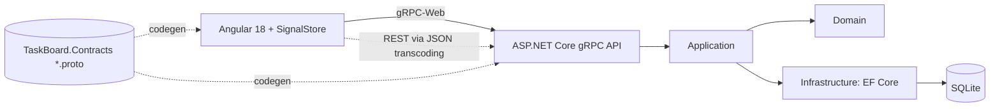

# TaskBoard – .NET 8 gRPC API + Angular 18 (SignalStore)
A learning project: a small Kanban-style **TaskBoard** built to practice **gRPC on .NET 8** and **Angular 18 with NgRx SignalStore**.
It is a study project, not production software.

## What it demonstrates
- Contract-first design with Protocol Buffers (`.proto` files as the single source of truth)
- gRPC unary calls (CRUD) and **server streaming** (live board updates)
- **gRPC-Web** so a browser client can talk to a gRPC server
- **gRPC JSON transcoding**: the same services exposed as REST + Swagger, for a gRPC vs REST comparison
- EF Core with **SQLite** and migrations
- Cross-cutting concerns: interceptors, gRPC status codes, validation, deadlines
- Angular standalone components with **NgRx SignalStore** (`withEntities`, `rxMethod`, optimistic updates)

## Tech stack
| Area | Technology |
|---|---|
| API | .NET 8, ASP.NET Core gRPC, Grpc.AspNetCore.Web |
| Data | EF Core + SQLite |
| Client | Angular 18.2, Angular Material, `@ngrx/signals` 18.x |
| gRPC client | `@protobuf-ts/grpcweb-transport` |
| Tooling | Node 20, npm 10, `dotnet-ef`, `grpcurl` / `grpcui` |

## Architecture


Planned layout (monorepo, client and server are independent projects):

```
src/
  TaskBoard.Contracts/      # .proto files
  TaskBoard.Api/            # gRPC services, interceptors, gRPC-Web, transcoding
  TaskBoard.Application/    # use cases, mapping, validation
  TaskBoard.Domain/         # entities
  TaskBoard.Infrastructure/ # DbContext, migrations
client/
  taskboard-web/            # Angular app
TaskBoard.sln
```

## Getting started
_Filled in as the project takes shape._

```bash
# API (http://localhost:5063)
dotnet run --project src/TaskBoard.Api --launch-profile http

# Client (http://localhost:4200)
cd client/taskboard-web
npm install
npm start      # generates the gRPC clients from the .proto files first, then ng serve
```

Tests and build commands for both sides: `dotnet test TaskBoard.sln` for the API, and see [client/taskboard-web/README.md](client/taskboard-web/README.md) for the client.

## REST and Swagger (JSON transcoding)
The same service classes also answer plain REST/JSON, so `curl`, scripts and other HTTP clients can use the API without a gRPC client. Routes come from `google.api.http` options in the `.proto` files; there is no second implementation, so the interceptors, validation and status codes are the same (`NotFound` becomes 404, `InvalidArgument` 400, `Aborted` 409, ...). `WatchBoard` is gRPC-only on purpose - a long-lived stream is not request/response JSON.

With the API running in Development, **Swagger UI** is at <http://localhost:5063/swagger>. It documents exactly the REST routes, which is why it needs transcoding: a plain gRPC service has no URL/verb/JSON shape to describe.

```bash
curl -X POST http://localhost:5063/v1/boards -H "Content-Type: application/json" -d '{"name":"Sprint 1"}'
curl http://localhost:5063/v1/boards
curl -X POST http://localhost:5063/v1/boards/1/tasks -H "Content-Type: application/json" -d '{"title":"Write docs","status":"TASK_ITEM_STATUS_TODO"}'
# FieldMask over REST: the body carries the values, the query names the fields to apply
curl -X PATCH "http://localhost:5063/v1/tasks/1?updateMask=status" -H "Content-Type: application/json" -d '{"status":"TASK_ITEM_STATUS_DONE"}'
curl http://localhost:5063/v1/boards/999   # HTTP 404, JSON error body with "message": "Board 999 not found."
```

JSON follows the standard proto3 mapping: `camelCase` field names, enums as their proto names, `Timestamp` as an ISO-8601 string.

### gRPC vs REST for the same data
Measured on this API (uncompressed bodies, one board with 20 tasks; gRPC framing and HTTP headers are not counted):

| Response | gRPC (protobuf) | REST (JSON) |
|---|---|---|
| One board | 44 B | 104 B |
| 20 tasks of a board | 2131 B | 6384 B |

Protobuf is about 2-3x smaller because field names are numbers and values are packed. JSON is readable in DevTools and works everywhere, protobuf needs the generated client (or the `.proto` file) to read. Compression narrows the size gap; it was not measured here.

| | gRPC / gRPC-Web | REST via transcoding |
|---|---|---|
| Client needs | generated client or `.proto` | any HTTP client |
| Best for | our Angular app, service-to-service | scripts, `curl`, third parties, Swagger |
| Streaming | yes (`WatchBoard`) | no |

## Roadmap
- [ ] 0. Repository setup (.gitignore, README)
- [ ] 1. Solution and Angular skeleton, CORS + gRPC-Web
- [ ] 2. Proto design (`taskboard.v1`)
- [ ] 3. Backend CRUD with EF Core + SQLite migrations
- [ ] 4. Interceptors, error handling, deadlines
- [ ] 5. Angular foundation and generated gRPC clients
- [ ] 6. State management with SignalStore
- [ ] 7. Server streaming (`WatchBoard`)
- [ ] 8. REST comparison via JSON transcoding
- [ ] 9. Optional: JWT auth, PostgreSQL/Docker, client and bidirectional streaming, tests

## License
MIT – see [LICENSE](LICENSE).
