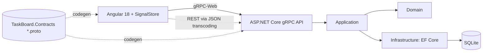

# TaskBoard – .NET 8 gRPC API + Angular 18 (SignalStore)
A learning project: a small Kanban-style **TaskBoard** built to practice **gRPC on .NET 8** and **Angular 18 with NgRx SignalStore**.
It is a study project, not production software.

## What it demonstrates
- Contract-first design with Protocol Buffers (`.proto` files as the single source of truth)
- gRPC unary calls (CRUD) and **server streaming** (live board updates)
- **gRPC-Web** so a browser client can talk to a gRPC server
- **gRPC JSON transcoding**: the same services exposed as REST + Swagger, for a gRPC vs REST comparison
- EF Core with **SQLite** and migrations
- Cross-cutting concerns: interceptors, gRPC status codes, request validation
- Angular standalone components with **NgRx SignalStore** (`withEntities`, `rxMethod`, optimistic updates with rollback)
- Kanban board with CDK drag-drop, filters and live updates between browser tabs
- Tests on three levels (xUnit, Jasmine, Playwright) and CI on every pull request
- An AI-assisted workflow with Claude Code: `CLAUDE.md`, hooks, subagents, skills, MCP and AI PR review (see [How AI was used](#how-ai-was-used))

## Tech stack
| Area | Technology |
|---|---|
| API | .NET 8, ASP.NET Core gRPC, Grpc.AspNetCore.Web |
| Data | EF Core + SQLite |
| Client | Angular 18.2, Angular Material, `@ngrx/signals` 18.x |
| gRPC client | `@protobuf-ts/grpcweb-transport` |
| Tests | xUnit + `WebApplicationFactory`, Jasmine/Karma, Playwright |
| Tooling | Node 20, npm 10, `dotnet-ef`, GitHub Actions, Claude Code |

## Architecture


Layout (monorepo, client and server are independent projects):

```
src/
  TaskBoard.Contracts/      # .proto files (single source of truth)
  TaskBoard.Api/            # gRPC services, interceptors, validation, streaming, gRPC-Web, transcoding
  TaskBoard.Application/    # proto <-> domain mapping
  TaskBoard.Domain/         # entities
  TaskBoard.Infrastructure/ # DbContext, EF configurations, migrations
tests/
  TaskBoard.Api.Tests/      # xUnit: mapping unit tests + gRPC/REST integration tests
client/
  taskboard-web/            # Angular app (src/app/<feature>/data-access|feature|ui) + e2e/ (Playwright)
.claude/                    # Claude Code hooks, subagents and skills
.github/                    # CI, Claude review workflows, PR template
TaskBoard.sln
```

## Getting started
Prerequisites: .NET 8 SDK (pinned in `global.json`), Node 20 + npm 10, and the EF Core CLI (`dotnet tool install --global dotnet-ef`).

```bash
# Database: creates src/TaskBoard.Api/taskboard.db (SQLite) from the migrations
dotnet ef database update --project src/TaskBoard.Infrastructure --startup-project src/TaskBoard.Api

# API (http://localhost:5063, Swagger UI at /swagger)
dotnet run --project src/TaskBoard.Api --launch-profile http

# Client (http://localhost:4200)
cd client/taskboard-web
npm install
npm start      # generates the gRPC clients from the .proto files first, then ng serve
```

Tests:

```bash
dotnet test TaskBoard.sln                                   # backend: unit + integration
cd client/taskboard-web
npx ng test --watch=false --browsers=ChromeHeadless         # client specs
npx playwright install chromium                             # once per machine
npm run e2e                                                 # Playwright, own API (:5180) and ng serve (:4300)
```

More client commands: [client/taskboard-web/README.md](client/taskboard-web/README.md).

## REST and Swagger (JSON transcoding)
The same service classes also answer plain REST/JSON, so `curl`, scripts and other HTTP clients can use the API without a gRPC client. Routes come from `google.api.http` options in the `.proto` files; there is no second implementation, so the interceptors, validation and status codes are the same (`NotFound` becomes 404, `InvalidArgument` 400, `Aborted` 409, ...). `WatchBoard` is gRPC-only on purpose - a long-lived stream is not request/response JSON.

Transcoding is enabled in every environment and, like the gRPC endpoints, the API has no authentication (a deliberate scope limit of this learning project). Only Swagger is Development-only.

With the API running in Development, **Swagger UI** is at <http://localhost:5063/swagger>. It documents exactly the REST routes, which is why it needs transcoding: a plain gRPC service has no URL/verb/JSON shape to describe.

```bash
curl -X POST http://localhost:5063/v1/boards -H "Content-Type: application/json" -d '{"name":"Sprint 1"}'
curl http://localhost:5063/v1/boards
curl -X POST http://localhost:5063/v1/boards/1/tasks -H "Content-Type: application/json" -d '{"title":"Write docs","status":"TASK_ITEM_STATUS_TODO"}'
# FieldMask over REST: the body carries the values, the query names the fields to apply
# (camelCase as in the JSON, e.g. updateMask=dueDate,labelIds, or the snake_case proto names)
curl -X PATCH "http://localhost:5063/v1/tasks/1?updateMask=status" -H "Content-Type: application/json" -d '{"status":"TASK_ITEM_STATUS_DONE"}'
curl http://localhost:5063/v1/boards/999   # HTTP 404, JSON error body with "message": "Board 999 not found."
```

JSON follows the standard proto3 mapping: `camelCase` field names, enums as their proto names, `Timestamp` as an ISO-8601 string.

### gRPC vs REST for the same data
Measured on this API (uncompressed bodies, one board with 20 tasks; gRPC framing and HTTP headers are not counted):

| Response | gRPC (protobuf) | REST (JSON) |
|---|---|---|
| One board | 44 B | 104 B |
| 20 tasks of a board | 2131 B | 6384 B |

Protobuf is about 2-3x smaller because field names are numbers and values are packed. JSON is readable in DevTools and works everywhere, protobuf needs the generated client (or the `.proto` file) to read. Compression narrows the size gap; it was not measured here.

| | gRPC / gRPC-Web | REST via transcoding |
|---|---|---|
| Client needs | generated client or `.proto` | any HTTP client |
| Best for | our Angular app, service-to-service | scripts, `curl`, third parties, Swagger |
| Streaming | yes (`WatchBoard`) | no |

## How AI was used
The project was built with **Claude Code** as the only AI tool, starting from plain prompts and growing into a configured workflow:
- [CLAUDE.md](CLAUDE.md) – project context, commands and rules for every session.
- [Hooks](.claude/hooks/) – ask before `git commit`/`push`, protect generated code and migrations, regenerate the TypeScript clients after a `.proto` change.
- [Subagents](.claude/agents/) – `dotnet-backend`, `angular-frontend`, `test-engineer`, read-only `code-reviewer`.
- [Skills](.claude/skills/) – `pr-draft` (drafts and opens a PR from the branch), `signalstore-feature`, `add-grpc-rpc`, `ef-migration`.
- [Playwright MCP](.mcp.json) – lets Claude explore the running UI.
- GitHub: [CI](.github/workflows/ci.yml), an automatic [Claude PR review](.github/workflows/claude-code-review.yml) and [`@claude` on demand](.github/workflows/claude.yml). The [pull requests](https://github.com/hrimar/taskboard-dotnet-grpc-angular-signalstore/pulls?q=is%3Apr) show the reviews and the replies.

## Roadmap
- [x] 0. Repository setup (.gitignore, README)
- [x] 1. Solution and Angular skeleton, CORS + gRPC-Web
- [x] 2. Proto design (`taskboard.v1`)
- [x] 3. Backend CRUD with EF Core + SQLite migrations
- [x] 4. Interceptors, error handling, request validation
- [x] 5. Angular foundation and generated gRPC clients
- [x] 6. State management with SignalStore (boards UI, Kanban with drag-drop)
- [x] 7. Server streaming (`WatchBoard`)
- [x] 8. REST comparison via JSON transcoding + Swagger
- [x] 9. Tests (xUnit, Jasmine, Playwright) and CI
- [ ] Ideas: label management page, sorting and due-date filter, client-side deadlines, JWT auth, PostgreSQL/Docker, client and bidirectional streaming

## License
MIT – see [LICENSE](LICENSE).
